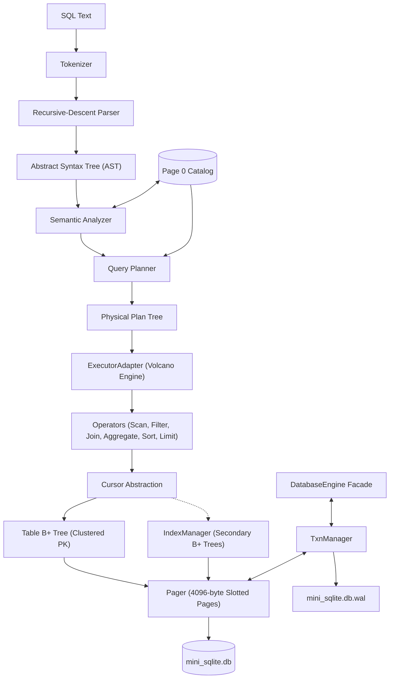

# Mini-SQLite
### A Custom Relational Database Management System in C++17

Mini-SQLite is an educational, SQLite-inspired relational database management system implemented from scratch in C++17. It features a complete SQL frontend, a Volcano iterator query execution engine, slotted-page on-disk storage with B+ tree indexing, secondary indexes with duplicate-key support, and ACID multi-statement transactions backed by physical whole-page Write-Ahead Logging (WAL) and crash recovery.

> **Note:** Mini-SQLite is an educational systems programming project designed to demonstrate core database management internals. It is not a drop-in replacement for production SQLite.

---

## 1. Motivation & Objectives

Modern relational database engines are complex software systems comprising language parsers, query optimizers, memory managers, indexing algorithms, and recovery protocols. Mini-SQLite was built from the ground up to explore and demonstrate these principles:
- **Clean Architectural Layering:** Clear boundary separation between frontend compilation, execution planning, B+ tree storage, and transaction logging.
- **On-Disk Persistence:** Real 4096-byte page storage and B+ tree node layouts rather than purely in-memory data structures.
- **Physical WAL & Crash Durability:** Physical whole-page write-ahead logging guaranteeing atomic commits and automatic crash recovery across sudden process termination.
- **Comprehensive Verification:** Rigorous automated test coverage spanning unit tests, query-plan validation, multi-statement abort regressions, and multi-process file locking.

---

## 2. Key Features

| Subsystem | Features |
| :--- | :--- |
| **SQL Frontend** | Tokenizer (lexer), recursive-descent parser, strongly typed AST, semantic analysis with catalog validation, and rule-based query planner. |
| **Query Engine** | Classic Volcano iterator (pull) model (`open`, `next`, `close`). Supports `SeqScan`, `IndexScan`, `Filter`, `NestedLoopJoin`, `Aggregate`, `Sort`, and `Limit`. |
| **SQL Operations** | `CREATE TABLE`, `CREATE INDEX`, `INSERT`, `UPDATE`, `DELETE`, `SELECT`, `WHERE`, `JOIN ... ON`, `GROUP BY`, `HAVING`, `ORDER BY`, `LIMIT`. |
| **Aggregate Functions** | `COUNT(*)`, `COUNT(col)`, `SUM(col)`, `AVG(col)`, `MIN(col)`, `MAX(col)`. |
| **Storage Engine** | Fixed 4096-byte pages, slotted-page architecture, binary row serialization, and clustered table B+ trees with primary key indexing. |
| **Secondary Indexes** | Independent B+ tree secondary indexes with duplicate key support via composite key encoding (`Value + PK`). |
| **Transactions & WAL** | Explicit (`BEGIN`, `COMMIT`, `ROLLBACK`) and automatic transactions; physical whole-page WAL; NO-STEAL buffer policy; REDO/UNDO crash recovery. |
| **Transaction Abort** | Explicit transaction abort state machine preventing partial-statement corruption after execution errors. |
| **Process Locking** | Exclusive OS-level file locking on the database and WAL log to prevent concurrent process collisions. |

---

## 3. Architecture Overview

Mini-SQLite separates query compilation, execution, storage, and transaction management into clean layers:



For complete technical specifications on each subsystem, see [docs/ARCHITECTURE.md](docs/ARCHITECTURE.md).

---

## 4. Transactions, Durability & Recovery

Mini-SQLite implements robust transaction safety through physical Write-Ahead Logging:
- **NO-STEAL Buffer Policy:** Uncommitted dirty pages are never written to `mini_sqlite.db` prior to a successful commit.
- **Before-Image Snapshots:** The first time a page is modified within a transaction, an unmodified copy is saved in memory (`before_images_`). Rollback restores these before-images instantly.
- **Physical Whole-Page WAL:** On `COMMIT`, all modified 4096-byte pages are written as `PAGE_WRITE` records followed by a `COMMIT` record to `mini_sqlite.db.wal` and flushed to disk before modifying the base database file.
- **Automatic Crash Recovery:** On startup, if a non-empty WAL is detected, `Recovery::recover()` scans the log. Committed transactions are replayed (REDO), while uncommitted or corrupted transactions are discarded (UNDO).
- **Explicit Transaction Abort:** If an error occurs during an explicit transaction, the transaction transitions to `ABORTED`. Further queries and `COMMIT` are rejected until the user issues `ROLLBACK`, guaranteeing atomicity.

For deep-dive documentation on WAL protocols and the abort state machine, see [docs/TRANSACTIONS_AND_RECOVERY.md](docs/TRANSACTIONS_AND_RECOVERY.md).

---

## 5. Build & Environment

### Prerequisites
- **Operating System:** Windows 10/11 x64
- **Compiler:** Microsoft Visual C++ Compiler (MSVC) 19.44+ supporting C++17
- **Build System:** CMake 3.14 or newer
- **Generator:** Visual Studio 17 2022 (or MSBuild Tools)

### Build Instructions
Clone the repository and run CMake from the project root:

```powershell
# 1. Configure the project using Visual Studio 2022 x64 generator
cmake -S . -B build -DCMAKE_GENERATOR="Visual Studio 17 2022" -A x64

# 2. Build the library, REPL executable, and test suite in parallel
cmake --build build --config Debug --parallel
```

### Running Automated Tests
Run the comprehensive CTest suite:

```powershell
ctest --test-dir build -C Debug --output-on-failure
```

---

## 6. Test Suite Baseline

Mini-SQLite maintains a 100% pass rate across all verification suites:

| Test Suite | Purpose | Result |
| :--- | :--- | :---: |
| **CTest Unit Tests** | Tokenizer, parser, catalog, sema, planner, storage, durability | **7 / 7 Passed** |
| **Durability & Abort Regressions** | WAL crash recovery, page extent sync, transaction abort state machine | **15 / 15 Passed** |
| **Runtime Integration Tests** | Volcano operator pipelines (IndexScan, Aggregates, Joins) | **6 / 6 Passed** |
| **SQL Integration Scripts** | End-to-end execution of 9 SQL test suites through the REPL engine | **9 / 9 Passed** |
| **Process Locking Tests** | Multi-process mutual exclusion, abnormal termination release, partial open | **5 / 5 Passed** |

For details on test cases and execution methodologies, see [docs/TESTING.md](docs/TESTING.md).

---

## 7. Quick Start & Demo

### Interactive REPL
Launch the compiled executable to enter the interactive shell:

```powershell
.\build\Debug\mini_sqlite.exe
```

Inside the REPL, execute SQL statements or dot-commands:

```sql
mini-sqlite> CREATE TABLE users (id INTEGER PRIMARY KEY, name TEXT, age INTEGER NOT NULL);
mini-sqlite> CREATE INDEX idx_age ON users (age);
mini-sqlite> INSERT INTO users VALUES (1, 'Alice', 25);
mini-sqlite> INSERT INTO users VALUES (2, 'Bob', 30);
mini-sqlite> SELECT * FROM users WHERE age >= 25;
id | name | age
---+------+----
1 | Alice | 25
2 | Bob | 30
(2 rows)
mini-sqlite> .tables
  users
mini-sqlite> .schema users
  Table: users
    [0] id INTEGER PRIMARY KEY NOT NULL
    [1] name TEXT
    [2] age INTEGER NOT NULL
  Indexes:
    idx_age ON age (root=2)
mini-sqlite> .exit
bye.
```

> **Note on REPL Input:** The interactive REPL driver consumes input line-by-line. Each SQL statement must be entered on a single line. Multiline queries should be fed through the programmatic C++ API.

### Executing the Demonstration Script
A complete demonstration script is provided in `examples/demo.sql`. You can execute it against the engine:

```powershell
Get-Content .\examples\demo.sql | .\build\Debug\mini_sqlite.exe
```

---

## 8. Documentation Index

- [docs/ARCHITECTURE.md](docs/ARCHITECTURE.md) — Comprehensive technical architecture, subsystem design, and Volcano model overview.
- [docs/TRANSACTIONS_AND_RECOVERY.md](docs/TRANSACTIONS_AND_RECOVERY.md) — Write-Ahead Logging (WAL), before-image snapshots, NO-STEAL policy, and crash recovery.
- [docs/SQL_REFERENCE.md](docs/SQL_REFERENCE.md) — Full syntax manual and examples for all supported SQL statements.
- [docs/LIMITATIONS.md](docs/LIMITATIONS.md) — Architectural simplifications, performance boundaries, and unsupported features.
- [docs/TESTING.md](docs/TESTING.md) — Complete breakdown of automated test suites and reproduction scenarios.

---

## 9. Known Limitations

As an educational DBMS, Mini-SQLite makes specific deliberate design trade-offs:
- **Concurrency:** Single-process access via exclusive OS file locks. No concurrent writers or MVCC.
- **Transactions:** No nested transactions or savepoints. Statement exceptions abort the transaction, requiring an explicit `ROLLBACK`.
- **Indexing:** Secondary index strings are hash-encoded (supporting equality lookups, but not lexical range scans).
- **Storage:** No B+ tree underflow page rebalancing or disk page reclamation on delete.
- **Queries:** No `OFFSET` clause or column arithmetic expressions.

For a detailed analysis and classification of all system boundaries, see [docs/LIMITATIONS.md](docs/LIMITATIONS.md).

---

## 10. Repository Structure

```text
mini-sqlite/
├── README.md
├── .gitignore
├── CMakeLists.txt
├── src/
│   ├── common/         # Shared AST nodes, token types, and row representations
│   ├── frontend/       # Tokenizer, recursive-descent parser, sema, catalog, planner
│   ├── exec/           # Volcano iterator execution operators (Scan, Filter, Join, Agg, Limit)
│   ├── storage/        # Pager (4KB pages), slotted B+ tree, indexes, WAL, recovery, transactions
│   ├── engine/         # DatabaseEngine facade and catalog serializer
│   └── main.cpp        # Interactive REPL command-line interface
├── tests/
│   ├── test_*.cpp      # CTest unit test drivers (tokenizer, parser, catalog, sema, storage, etc.)
│   ├── test_durability.cpp  # WAL crash recovery & transaction abort regressions
│   ├── test_locking.cpp     # Multi-process mutual exclusion tests
│   ├── integration/    # 9 end-to-end SQL test scripts (.sql)
│   ├── run_integration.ps1
│   └── run_locking_test.ps1
├── docs/
│   ├── ARCHITECTURE.md
│   ├── TRANSACTIONS_AND_RECOVERY.md
│   ├── SQL_REFERENCE.md
│   ├── TESTING.md
│   └── LIMITATIONS.md
└── examples/
    └── demo.sql        # Comprehensive executable SQL demonstration script
```

---

## 11. Platform Compatibility

- **Windows x64:** Fully supported, tested, and verified with MSVC and Visual Studio 2022.
- **Linux / macOS:** Not officially supported in the current release due to Windows-specific OS file locking primitives (`_fsopen` / `_SH_DENYRW`).

---

## 12. License

License: Not yet specified.