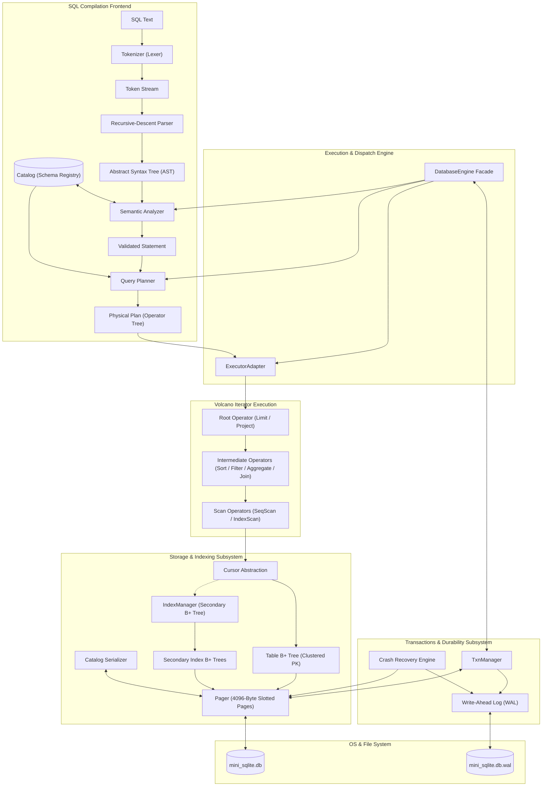

# Mini-SQLite Architecture

Mini-SQLite is a custom relational database management system implemented from scratch in C++17. It features a layered system architecture separating the SQL compilation frontend, the Volcano-iterator query execution engine, B+ tree indexing and slotted-page storage, and a physical Write-Ahead Logging (WAL) transaction manager.

---

## 1. System Overview & Architecture Flowchart



---

## 2. SQL Frontend Layer

The frontend processes raw SQL text into an executable physical plan through five distinct phases:

### A. Tokenizer (`src/frontend/tokenizer.cpp`, `src/common/token.cpp`)
- Scans raw character streams into discrete `Token` values.
- Case-insensitively recognizes SQL keywords (`SELECT`, `FROM`, `WHERE`, `JOIN`, `GROUP`, `BY`, `HAVING`, `ORDER`, `LIMIT`, `INSERT`, `UPDATE`, `DELETE`, `CREATE`, `TABLE`, `INDEX`, `BEGIN`, `COMMIT`, `ROLLBACK`, `PRIMARY`, `KEY`, `INTEGER`, `TEXT`, `REAL`).
- Tokenizes single-quoted string literals, integer numbers, real (floating point) numbers, identifiers, operators (`=`, `!=`, `<`, `>`, `<=`, `>=`), and punctuation (`(`, `)`, `,`, `;`, `.`).
- Skips whitespace and SQL single-line comments (`-- comment`).

### B. Recursive-Descent Parser (`src/frontend/parser.cpp`)
- Consumes tokens and constructs strongly-typed AST structures defined in [`src/common/ast.h`](file:///d:/New%20folder/SEM5/DBMS/DBMS%20Project/Anti_G/src/common/ast.h).
- Implements precedence-climbing for expressions:
  - Logical `OR` → `AND` → `NOT` → Comparisons (`=`, `!=`, `<`, `>`, `<=`, `>=`) → Operands (identifiers, literals, parenthesized expressions, aggregate calls).
- Produces distinct statement nodes:
  - `CreateTableStmt`: Table name and column definitions with `PRIMARY KEY` and `NOT NULL` constraints.
  - `CreateIndexStmt`: Index name, target table, and target column.
  - `InsertStmt`: Table name and literal value list.
  - `SelectStmt`: Projection expressions, table source, explicit `JOIN ... ON` clauses, optional `WHERE`, `GROUP BY`, `HAVING`, `ORDER BY`, and `LIMIT`.
  - `UpdateStmt`: Target table, assignments (`column = literal`), and optional `WHERE` predicate.
  - `DeleteStmt`: Target table and optional `WHERE` predicate.
  - `TxnStmt`: Transaction control (`BEGIN`, `COMMIT`, `ROLLBACK`).

### C. Semantic Analyzer (`src/frontend/sema.cpp`)
- Validates the AST against the catalog schema before planning or execution.
- Verifies table existence and column existence.
- Resolves table-qualified column references (`table.column`).
- Enforces single integer `PRIMARY KEY` constraint requirements.
- Validates type consistency for assignments and comparisons.
- Enforces that aggregate functions (`COUNT`, `SUM`, `AVG`, `MIN`, `MAX`) appear only in `SELECT` projections or `HAVING` clauses, never inside `WHERE`.
- Validates that non-aggregated projection columns appear in the `GROUP BY` list.

### D. Catalog (`src/frontend/catalog.cpp`, `src/engine/catalog_serializer.h`)
- Serves as the central in-memory schema registry.
- Tracks `TableSchema` (table name, column types, ordinal offsets, primary key name) and `IndexInfo` (index name, indexed column name, B+ tree root page ID).
- Persisted onto **Page 0** of the database file via `CatalogSerializer`, allowing complete schema reconstruction on database restart without external metadata files.

### E. Query Planner (`src/frontend/planner.cpp`)
- Converts validated `SelectStmt` ASTs into a tree of physical plan operators (`PlanOp` variant):
  - **Index Selection:** Evaluates the `WHERE` predicate. If an equality condition matches an indexed column (`col = value`), the planner selects an `IndexScanOp` instead of a full sequential scan.
  - **Join Planning:** Emits a `NestedLoopJoinOp` with inner/outer scan nodes and join predicates.
  - **Filter Placement:** Wraps scans with `FilterOp` for residual predicates.
  - **Aggregation:** Injects `AggregateOp` with grouping expressions and aggregate function specifications.
  - **Sorting & Limiting:** Injects `SortOp` for `ORDER BY` specifications and wraps with `LimitOp` when `LIMIT` is specified.

---

## 3. Query Execution Engine

The execution engine follows the classic **Volcano iterator (pull) model**. Every execution operator implements the [`Operator`](file:///d:/New%20folder/SEM5/DBMS/DBMS%20Project/Anti_G/src/common/cursor_interface.h) interface:

```cpp
class Operator {
public:
    virtual ~Operator() = default;
    virtual void open() = 0;
    virtual std::optional<Row> next() = 0;
    virtual void close() = 0;
};
```

### Execution Operators
1. **`SeqScan` (`src/exec/seq_scan.h`):** Iterates over the entire clustered table B+ tree using a `TableCursor`.
2. **`IndexScan` (`src/exec/index_scan.h`):** Probes a secondary index B+ tree for matching keys and fetches the primary key to retrieve the full table row via point lookup.
3. **`Filter` (`src/exec/filter.h`):** Evaluates boolean expressions on tuples pulled from its child operator and passes only qualifying rows.
4. **`NestedLoopJoin` (`src/exec/nested_loop_join.h`):** Buffers outer table rows and performs an exhaustive nested-loop iteration over the inner relation, evaluating the join predicate.
5. **`Aggregate` (`src/exec/aggregate.h`):** Computes scalar and grouped aggregations (`COUNT(*)`, `COUNT(col)`, `SUM`, `AVG`, `MIN`, `MAX`) using an in-memory hash map. Filters groups with `HAVING` predicates.
6. **`Sort` (`src/exec/sort.h`):** Materializes child tuples in memory and sorts them using `std::stable_sort` based on ascending/descending expressions.
7. **`Limit` (`src/exec/limit.h`):** Tracks the number of returned tuples and terminates early once `limit_count` tuples are emitted.
8. **`ExecutorAdapter` (`src/exec/executor_adapter.h`):** Recursively translates the planner's physical operator plan into instantiated `Operator` pipelines connected to underlying storage cursors.

---

## 4. Storage Engine & Indexing

The storage subsystem manages disk persistence, page caching, record layouts, and B+ tree indexes.

### A. Pager (`src/storage/pager.cpp`, `src/storage/pager.h`)
- Manages fixed-size **4096-byte pages** (`PAGE_SIZE = 4096`).
- Implements an in-memory page cache (`std::unordered_map<PageId, Page>`).
- Controls disk I/O through synchronous `std::fstream` reads and writes.
- Manages page allocation and tracks total page extent (`total_pages_`).
- Synchronizes with recovery to ensure database extent matches restored allocations.

### B. Slotted-Page Layout (`src/storage/btree_node.h`)
Leaf pages and interior nodes utilize a slotted structure:
- **Header (16 bytes):**
  - Node Type (1 byte: `LEAF` or `INTERNAL`)
  - Is Root (1 byte)
  - Number of Keys (2 bytes)
  - Parent Page ID (4 bytes)
  - Next Leaf Page ID (4 bytes: leaf node sibling linkage)
- **Leaf Cells:** Array of cells containing `(key: int64_t, row_size: uint16_t, row_data: bytes)`.
- **Internal Cells:** Array of child page pointers and delimiter keys `(child_page_id: uint32_t, key: int64_t)`.

### C. Row Serialization (`src/storage/row_serializer.h`)
- Converts in-memory `Row` objects (`std::vector<Value>`) into compact binary byte buffers and vice versa.
- Type tags define serialized formats:
  - `INTEGER`: 8-byte signed integer (little-endian).
  - `REAL`: 8-byte IEEE-754 double precision float.
  - `TEXT`: 4-byte length prefix followed by raw UTF-8 string bytes.
  - `NULL`: 1-byte null indicator.

### D. Table B+ Tree (`src/storage/btree.h`)
- Serves as the primary clustered storage for tables.
- Rows are indexed by their 64-bit integer `PRIMARY KEY`.
- Automatically handles node splits when a leaf or interior node exceeds 4096 bytes.
- Supports point lookups, sequential scans, row insertions, and deletions.

### E. Secondary Indexing (`src/storage/index_manager.h`)
- Created via `CREATE INDEX idx ON table(col)`.
- Implemented as an independent B+ tree.
- **Duplicate Key Support:** Secondary keys are stored as composite entries combining the indexed column value and the row's primary key (`composite_key = Value + PK`).
- String keys are hash-encoded into 64-bit integers for indexing.

---

## 5. Database Engine Facade (`src/engine/db_engine.cpp`)

The `DatabaseEngine` class coordinates all subsystems:
- **File Management:** Opens and locks `mini_sqlite.db` and `mini_sqlite.db.wal` with exclusive OS file locks.
- **Catalog Management:** Reads and deserializes Page 0 on startup; persists catalog updates on DDL operations.
- **Execution Dispatch:** Routes parsed statements to appropriate handlers:
  - DDL (`CREATE TABLE`, `CREATE INDEX`): Allocates B+ tree root pages and updates catalog.
  - DML (`INSERT`, `UPDATE`, `DELETE`): Validates constraints, mutates B+ trees and secondary indexes within transaction blocks.
  - Query (`SELECT`): Compiles, optimizes, and iterates Volcano operator trees, outputting formatted tabular results.
- **Transaction State Machine:** Coordinates explicit (`BEGIN`, `COMMIT`, `ROLLBACK`) and automatic single-statement transactions via `TxnManager`.
