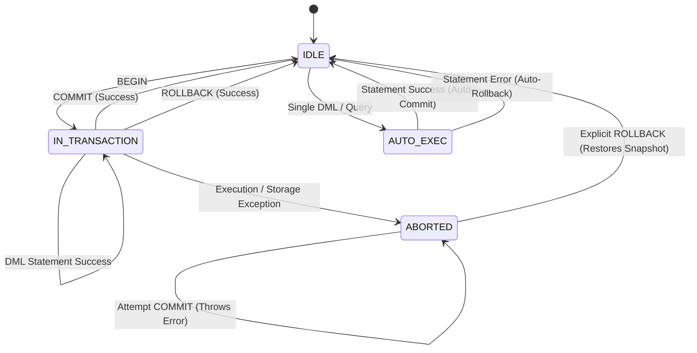
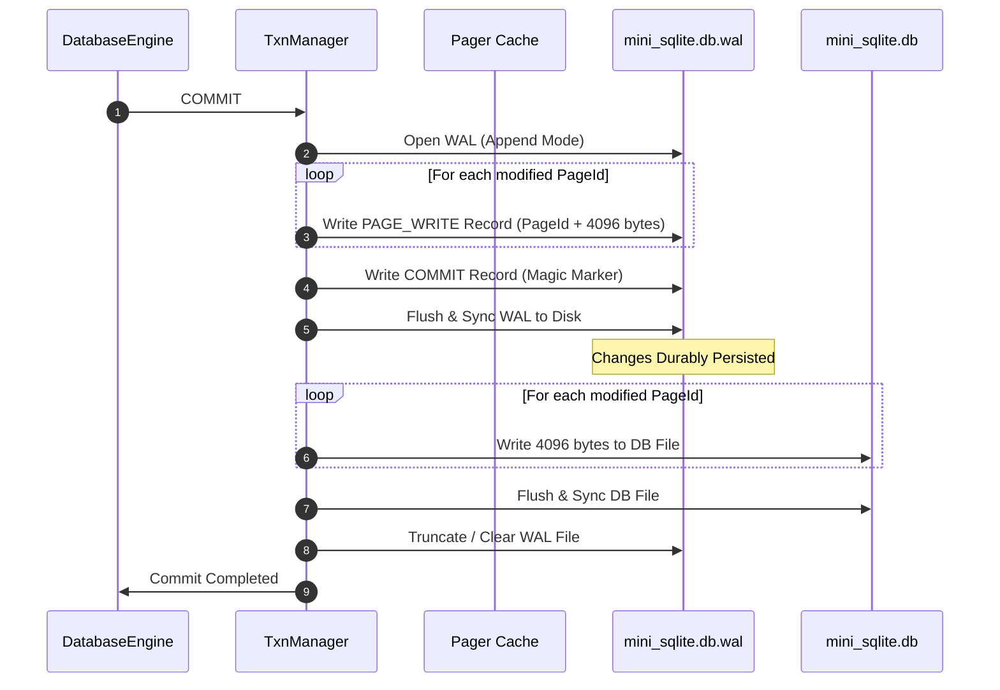
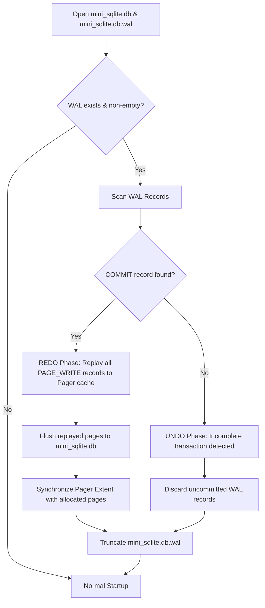

# Transactions and Crash Recovery

Mini-SQLite implements ACID transaction semantics and crash durability using **physical whole-page Write-Ahead Logging (WAL)**, a **NO-STEAL buffer policy**, in-memory before-image snapshots, and an explicit transaction-abort state machine.

---

## 1. Transaction Model & Lifecycle

Mini-SQLite supports both automatic (implicit single-statement) transactions and explicit multi-statement transactions.



### Automatic Transactions
- When a DML statement (`INSERT`, `UPDATE`, `DELETE`) is executed outside an explicit `BEGIN ... COMMIT` block, `DatabaseEngine` automatically starts a transaction.
- If execution completes successfully, the transaction commits immediately.
- If execution throws any semantic, storage, or constraint exception, the transaction automatically rolls back, restoring all pages to their pre-statement state.

### Explicit Transactions
- Initiated explicitly with `BEGIN`.
- Changes across multiple statements accumulate atomically within the transaction buffer.
- Terminated explicitly with `COMMIT` (persisting all modifications) or `ROLLBACK` (reverting all modifications).

---

## 2. In-Memory Snapshots & Buffer Policy

Mini-SQLite implements a strict **NO-STEAL** buffer policy with first-write-wins before-image tracking.

### A. First-Write-Wins Before-Image Semantics
- When a transaction begins, dirty page tracking is initialized.
- Whenever a page is about to be modified for the first time during the transaction, the `Pager` captures an unmutated snapshot of that 4096-byte page into `before_images_`:
  ```cpp
  if (before_images_.find(page_id) == before_images_.end()) {
      before_images_[page_id] = *original_page;
  }
  ```
- Subsequent writes to the same page within the same transaction do not overwrite the before-image. This guarantees that the snapshot always reflects the exact state at transaction start.

### B. NO-STEAL Buffer Policy
- Uncommitted modified pages are retained in the `Pager` cache and are **never written to the base database file** (`mini_sqlite.db`) before commit.
- If an explicit or automatic transaction rolls back:
  1. The before-images in `before_images_` are copied back into the active `Pager` cache.
  2. Any newly allocated pages beyond the original extent are discarded.
  3. The base database file on disk remains completely unpolluted by uncommitted data.

---

## 3. Write-Ahead Logging (WAL) Protocol

Durability is achieved by appending physical whole-page records to `mini_sqlite.db.wal` before modifying the database file.



### WAL Record Format
The WAL consists of fixed-size binary records:
1. **`PAGE_WRITE` Record:**
   - Record Type (1 byte): `0x01`
   - Page ID (4 bytes, unsigned integer)
   - Page Data (4096 bytes: raw physical page contents)
2. **`COMMIT` Record:**
   - Record Type (1 byte): `0x02`
   - Commit Marker / Timestamp

### Write Ordering & Durability Guarantee
1. **Deferred Logging:** Modifications accumulate in memory during the transaction.
2. **WAL Write:** On `COMMIT`, all dirty pages are written as `PAGE_WRITE` records followed by a `COMMIT` record to the WAL file.
3. **WAL Flush:** The WAL file is flushed to physical storage using OS sync primitives.
4. **Base File Write:** Once the WAL is durably written, the pages are written to `mini_sqlite.db`.
5. **WAL Checkpoint:** The WAL is truncated once the base database file reflects all committed changes.

---

## 4. Crash Recovery (REDO / UNDO)

If the process crashes or terminates unexpectedly, `Recovery::recover()` executes automatically during `DatabaseEngine` startup.



### A. REDO Phase (Committed Transactions)
- The recovery engine scans the WAL from beginning to end.
- If a terminal `COMMIT` record is encountered, all preceding `PAGE_WRITE` records in that transaction block are confirmed committed.
- Each page is replayed directly into the `Pager` cache and flushed to `mini_sqlite.db`.

### B. UNDO Phase (Incomplete Transactions)
- If the WAL ends without a matching `COMMIT` record (indicating a crash occurred mid-transaction or mid-flush), the transaction is considered aborted.
- Under the NO-STEAL policy, partial writes were never synced to `mini_sqlite.db`.
- The uncommitted WAL records are discarded and the WAL file is cleaned up.

### C. Catalog Page 0 Handling & Extent Synchronization
- When tables or indexes are created or expanded, **Page 0** (catalog metadata) and new page allocations are included in the WAL.
- During recovery, Page 0 is restored, and `Pager::sync_extent()` recalculates the actual database file length to ensure the pager extent matches all allocated pages.

---

## 5. Explicit Transaction-Abort State Machine

To prevent partial-statement corruption inside multi-statement transactions, Mini-SQLite enforces strict abort semantics:

### The Problem Solved
If a multi-row statement (e.g. `UPDATE t SET val = val + 1`) modifies some rows before encountering a constraint error (e.g., duplicate primary key), the database could be left in a partially mutated state. If the user subsequently issued `COMMIT`, partial changes would be persisted.

### Implemented Abort Behavior
1. **Transition to `ABORTED`:**
   - Any runtime execution error (such as a duplicate key or storage capacity limit) inside an explicit transaction immediately transitions the engine's transaction state to `TxnState::ABORTED`.
2. **Rejection of Subsequent Operations:**
   - While in `ABORTED` state, any subsequent `SELECT`, `INSERT`, `UPDATE`, `DELETE`, or `BEGIN` statement throws:
     `"Transaction is aborted, commands ignored until end of transaction block; must ROLLBACK"`
   - Attempting `COMMIT` while in `ABORTED` state throws:
     `"Transaction is aborted: cannot COMMIT; must ROLLBACK"`
3. **Restoration on `ROLLBACK`:**
   - The user must issue `ROLLBACK`.
   - `ROLLBACK` restores all pages to their original `before_images_` snapshot, clears dirty page flags, and resets the transaction state to `TxnState::IDLE`.
4. **Syntax Error Handling:**
   - Syntax errors are caught by the parser before statement execution begins, leaving the transaction state unchanged.

---

## 6. Process Locking

Mini-SQLite enforces single-process database access using operating system file locking:
- Both `mini_sqlite.db` and `mini_sqlite.db.wal` are opened with exclusive share modes (`_SH_DENYRW` on Windows).
- If a second process attempts to open an active database, initialization fails immediately with an `ERROR_LOCKED` exception.
- If the operating process terminates abnormally (e.g. `SIGKILL`), the OS kernel automatically releases the file locks, allowing subsequent processes to open the database and trigger WAL crash recovery cleanly.
- If WAL file locking fails after opening the DB file, the engine cleanly closes the DB file handle to prevent orphaned locks.
